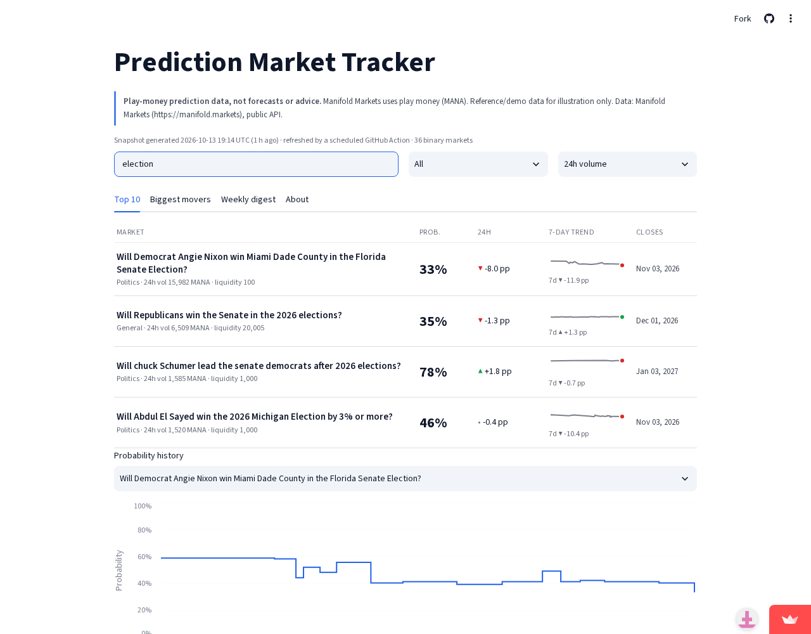
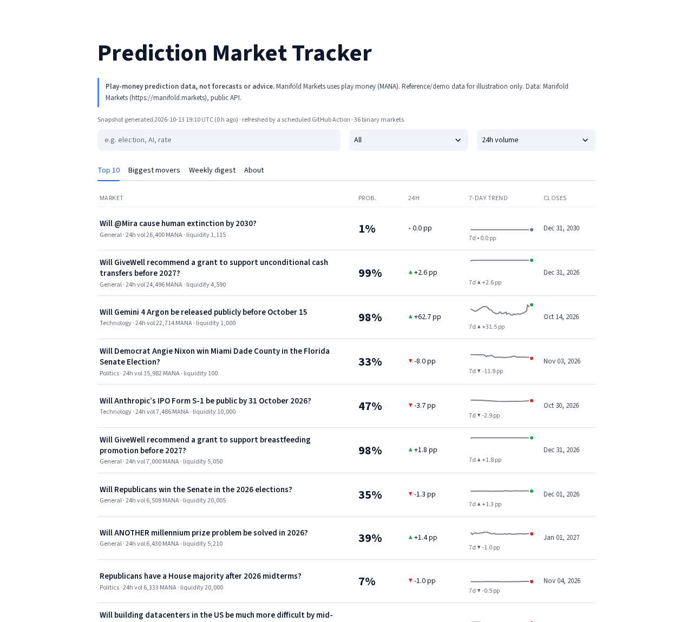
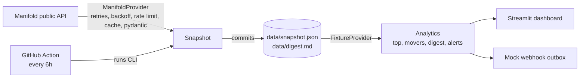

# Prediction Market Tracker

[](https://github.com/alfiochoa/prediction-market-tracker/actions/workflows/ci.yml) [](https://prediction-market-tracker.streamlit.app/)

**A dashboard that turns a noisy prediction-market feed into a clear view: top active markets, who moved, and a weekly digest, with a data pipeline that keeps itself fresh.**

> **Play-money prediction data, not forecasts or advice.** [Manifold Markets](https://manifold.markets) uses play money (MANA). This is reference/demo data for illustration. There are no trading features and nothing here is investment advice. Timestamps are shown in the UI.

**Live demo:** https://prediction-market-tracker.streamlit.app/





## Features
- Top 10 active **binary** markets by 24h volume, liquidity or total volume, with probability, 24h change, close date
- 7-day probability **sparklines** and a detail history chart per market (table view available)
- **Biggest movers** (24h / 7d, adjustable threshold) with a **mocked webhook** (payloads go to a local outbox; nothing is sent)
- Market **search** and **category** filter (Manifold topics)
- **"What moved this week"** digest generated as Markdown (`data/digest.md`, downloadable in the UI)
- Light + dark theme, mobile-friendly layout, never a blank page (bundled snapshot)

## Architecture

The UI only talks to the `Provider` interface. `FixtureProvider` reads the committed snapshot, so tests, CI and the demo run **offline**. `ManifoldProvider` is used only by the scheduled workflow (`python -m pmtracker.cli snapshot`); if the API fails it exits non-zero and the previous snapshot stays in place.

**Resilience:** 15s timeouts, 4 retries with exponential backoff + jitter (honours `Retry-After`), 0.3s minimum spacing between requests (well under Manifold's rate limit), 5-min on-disk cache, a User-Agent identifying this project, pydantic validation (invalid rows are skipped and logged), JSON-lines structured logs.

## Run locally
```bash
pip install -r requirements.txt
streamlit run streamlit_app.py
# refresh data from the live API (polite, ~100 requests):
PYTHONPATH=src python -m pmtracker.cli snapshot
# tests
pip install -r requirements-dev.txt && pytest -q
```

## Deploy (Streamlit Community Cloud)
Repo `alfiochoa/prediction-market-tracker`, branch `main`, main file `streamlit_app.py`. No secrets are needed.

## Data source and terms
- **Manifold Markets public API** (`https://api.manifold.markets/v0`), free, no key. Data is attributed to Manifold Markets. See their [API docs and terms](https://docs.manifold.markets/api); this project identifies itself with a User-Agent, caches, and fetches at most every 6 hours.
- Polymarket and Kalshi are intentionally **not** used.

## Limitations
- Play-money crowd probabilities: thin, sometimes joke or illiquid markets; not calibrated forecasts.
- 24h/7d changes are derived from bet history at snapshot time (up to 3,000 bets per market per week); extremely busy markets may be approximated.
- Snapshot covers about 36 markets (top by 24h volume across seven topics), so search and filters work within that set, not all of Manifold.
- Snapshot may be hours old; the UI shows its generation time.
